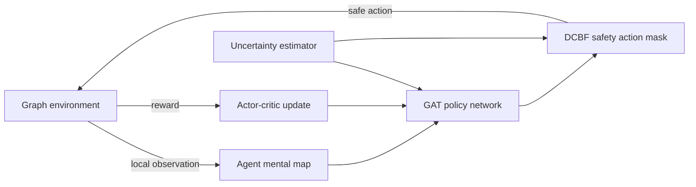

# DPMRL: Decentralized Persistent Monitoring on Graphs with Multi-Agent Deep Reinforcement Learning

[](https://www.python.org/)
[](https://pytorch.org/)
[](https://pytorch-geometric.readthedocs.io/)
[](https://pettingzoo.farama.org/)

**DPMRL** is a research codebase for training and evaluating teams of fully decentralized agents that solve the **persistent monitoring problem on networks** with **multi-agent reinforcement learning (MARL)**. Each agent uses a **graph neural network** policy, learns to estimate node uncertainty, and is steered by a **discrete-time control barrier function (DCBF)** style safety mask to keep uncertainty bounded while patrolling a graph.

_Author: Theodore Rogalski_

**Keywords:** persistent monitoring, multi-agent reinforcement learning, decentralized control, graph neural networks, graph attention networks, control barrier functions, safe reinforcement learning, PettingZoo, PyTorch Geometric, networked systems

---

## Table of Contents

- [What is persistent monitoring?](#what-is-persistent-monitoring)
- [Features](#features)
- [How it works](#how-it-works)
- [Repository layout](#repository-layout)
- [Installation](#installation)
- [Quick start: train a team of agents](#quick-start-train-a-team-of-agents)
- [Evaluation and baselines](#evaluation-and-baselines)
- [Creating custom graph environments](#creating-custom-graph-environments)
- [Model variants and ablations](#model-variants-and-ablations)
- [Project status](#project-status)
- [Citation](#citation)
- [Acknowledgements](#acknowledgements)

## What is persistent monitoring?

In persistent monitoring, a team of mobile agents must repeatedly revisit a set of target locations so that the uncertainty about each target never grows without bound. The environment here is a graph: some nodes are targets whose uncertainty rises every step they are unobserved, and an agent standing on a target reduces that uncertainty. Agents see only their local neighborhood, build their own internal map of the network, and must coordinate without a central controller.

## Features

- **Custom graph environments.** Networks are stored as `.graphml` files with per-node `uncertainty`, `agent_presence` and `target` attributes. Random graphs of any size can be generated.
- **PettingZoo-compatible environment.** `GraphEnv` is a PettingZoo `ParallelEnv` with an arbitrary number of agents.
- **Fully decentralized agents.** Every agent has its own actor-critic network, optimizer and uncertainty estimator, and acts on a private local "mental map" of the graph.
- **Graph neural network policies.** Graph attention (GAT) over node features enriched with Laplacian eigenvector features and a learned uncertainty prediction.
- **Safety through control barrier functions.** A DCBF-style action mask restricts moves to those that do not let predicted uncertainty degrade faster than a configurable rate.
- **Ablation-ready.** Model variants with and without the safety mask, state estimation, collision handling and extra attention.
- **Baselines.** Greedy "grazing", random-walk and sit-on-target policies for comparison.
- **Centralized counterpart.** A centralized-agent implementation lives alongside the decentralized one (work in progress).

## How it works



1. **Observe.** Each agent adds its radius-2 neighborhood to its own copy of the graph (its mental map).
2. **Estimate.** A per-agent uncertainty estimator predicts node uncertainty and is trained online.
3. **Encode.** Node features (uncertainty, agent presence, target flag), Laplacian eigenvectors and the uncertainty prediction are fed through a graph attention network.
4. **Act safely.** Policy logits are masked to legal moves (stay or move to a neighbor) that satisfy the barrier condition `h(x_{t+1}) >= (1 - eta) * h(x_t)`.
5. **Learn.** Each agent is trained with an advantage actor-critic loss (discount `gamma = 0.99`, Adam).

## Repository layout

```
dpmrl/
├── requirements.txt
├── TODO.md
└── custom_environment/
    ├── create_custom_graph.py          # random graph generator (.graphml)
    ├── graphs/                         # bundled graph files
    │   └── for_testing/                # node_20, node_50, node_100
    ├── decentralized_agents/
    │   ├── env/decentralized_graph_env.py        # GraphEnv (PettingZoo ParallelEnv)
    │   ├── training/decentralized_training.py    # trainer, actor-critic loss, checkpoints
    │   ├── training/decentralized_neural_model.py# per-agent uncertainty estimator
    │   ├── model_variants/                       # full model and ablations
    │   └── eval/eval.py                          # evaluation and baselines
    ├── centralized_agents/             # centralized counterpart (in progress)
    └── grid_based/                     # earlier grid-world experiments
```

## Installation

```bash
git clone https://github.com/theohrogalski/dpmrl
cd dpmrl
python -m venv .venv && source .venv/bin/activate
pip install -r requirements.txt
```

`requirements.txt` pins a full environment, including CUDA 12.4 builds of PyTorch 2.5.1 and its NVIDIA libraries. A CUDA GPU is used when available and the code falls back to CPU otherwise, but the pinned wheels are large, so you may prefer to install a CPU build of PyTorch first.

Scripts import from the `custom_environment` package and read graphs from `./graphs/...`, so run them from the `custom_environment` directory with the repository root on your path:

```bash
cd custom_environment
export PYTHONPATH=..
```

## Quick start: train a team of agents

```python
from custom_environment.decentralized_agents.model_variants.models_full_model_d import models_full_model
from custom_environment.decentralized_agents.training.decentralized_training import trainer

t = trainer(model=models_full_model, max_iters=20, saving_dir="full_model", max_moves=500)
t.train_loop(num_nodes=50, num_agents=4, random_seed=0)
```

`num_nodes` selects the graph `graphs/for_testing/node_<num_nodes>.graphml` (20, 50 and 100 are included). Checkpoints, containing each agent's policy network, uncertainty estimator and optimizer state, are written under `./checkpoints/`, and training metrics are logged to a file named `fm_<num_nodes>_<num_agents>`.

## Evaluation and baselines

`decentralized_agents/eval/eval.py` provides `algorithm_evaluator`:

| Method | Description |
| --- | --- |
| `full_model(...)` | Loads a trained checkpoint and rolls it out, logging per-step reward, action and total uncertainty. |
| `grazing()` | Greedy baseline: each agent travels the shortest path to the highest-uncertainty node. |
| `random()` | Random-walk baseline over legal moves. |
| `sit_on_nodes()` | Agents park on the first free target they reach. |

The main reported quantities are cumulative total uncertainty and the longest time any target went unvisited. Evaluation runs on the GPU by default and loads checkpoints from `./checkpoints/<ckpt>.pt`.

## Creating custom graph environments

```python
from custom_environment.create_custom_graph import create_custom_nx_graph

create_custom_nx_graph(
    num_nodes=100,
    output_name="100_nodes",
    random_chance_param_edge=20,    # percent chance of an edge between any two nodes
    random_chance_param_target=16,  # percent chance a node is a monitoring target
)
```

The graph is written to `./graphs/<output_name>.graphml`, so run this from `custom_environment` with a `graphs/` folder present. Node attributes must include `uncertainty`, `agent_presence` and `target`.

## Model variants and ablations

All variants live in `decentralized_agents/model_variants/`.

| Class | Ablation |
| --- | --- |
| `models_full_model` | Full model: GAT, Laplacian features, state estimation, DCBF safety mask |
| `models_no_dcbf` | Without the barrier-function safety mask |
| `models_no_state_est` | Without the uncertainty state estimator |
| `models_no_dcbsf_no_state_est` | Without both |
| `models_no_collision` | Without collision handling |
| `models_extra_attention` | Adds extra attention layers |

## Project status

DPMRL is active research code and is not yet a polished package. Known issues:

- Command-line interfaces for training and evaluation are being replaced with a proper parser; use the Python API shown above for now.
- Centralized training and evaluation are in progress.
- The `random()` and `sit_on_nodes()` baselines depend on a legal-action helper that is still being ported; `grazing()` and `full_model(...)` are self-contained.
- `requirements.txt` needs trimming.

Contributions, issues and questions are welcome.

## Citation

If you use this code in your research, please cite the repository:

```bibtex
@software{rogalski_dpmrl,
  author = {Rogalski, Theodore},
  title  = {DPMRL: Decentralized Persistent Monitoring on Graphs with Multi-Agent Deep Reinforcement Learning},
  year   = {2026},
  url    = {https://github.com/theohrogalski/dpmrl}
}
```

## Acknowledgements

Built on [PyTorch](https://pytorch.org/), [PyTorch Geometric](https://pytorch-geometric.readthedocs.io/), [PettingZoo](https://pettingzoo.farama.org/) and [NetworkX](https://networkx.org/).

This README.md was made using Claude Sonnet 5.5.
