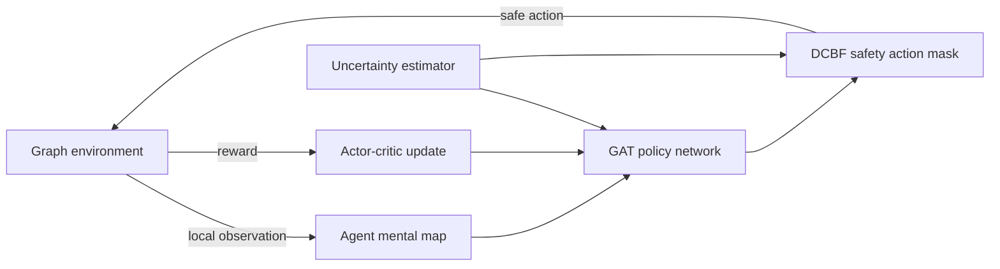
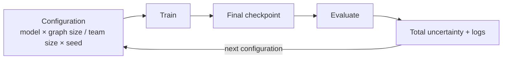

# DPMRL: Decentralized Persistent Monitoring on Graphs with Multi-Agent Deep Reinforcement Learning

[](https://www.python.org/)
[](https://pytorch.org/)
[](https://pytorch-geometric.readthedocs.io/)
[](https://pettingzoo.farama.org/)

**DPMRL** is a research codebase for training and evaluating teams of fully decentralized agents that solve the **persistent monitoring problem on networks** with **multi-agent reinforcement learning (MARL)**. Each agent uses a **graph neural network** policy, learns to estimate node uncertainty, and is steered by a **discrete-time control barrier function (DCBF)** style safety mask to keep uncertainty bounded while patrolling a graph. This code is a part of a paper published in the IEEE HKN Innovating the Future conference (Nov. 2026) which is also available on [arXiv](https://arxiv.org/abs/2609.36292). 

_Author: Theodore Rogalski_

**Keywords:** persistent monitoring, multi-agent reinforcement learning, decentralized control, graph neural networks, graph attention networks, control barrier functions, safe reinforcement learning, PettingZoo, PyTorch Geometric, networked systems

---

## Table of Contents

- [What is persistent monitoring?](#what-is-persistent-monitoring)
- [Features](#features)
- [How it works](#how-it-works)
- [Repository layout](#repository-layout)
- [Installation](#installation)
- [Tutorial: train and evaluate decentralized and centralized agents](#tutorial-train-and-evaluate-decentralized-and-centralized-agents)
  - [Automatic training and testing](#automatic-training-and-testing)
  - [Step by step: decentralized agents](#step-by-step-decentralized-agents)
  - [Step by step: centralized agents](#step-by-step-centralized-agents)
- [Creating custom graph environments](#creating-custom-graph-environments)
- [Model variants and ablations](#model-variants-and-ablations)
- [Project status](#project-status)
- [Citation](#citation)
- [Acknowledgements](#acknowledgements)

## What is persistent monitoring?

In persistent monitoring, a team of mobile agents must repeatedly revisit a set of target locations so that the uncertainty about each target never grows without bound. The environment here is a graph: some nodes are targets whose uncertainty rises every step they are unobserved, and an agent standing on a target reduces that uncertainty. Agents see only their local neighborhood, build their own internal map of the network, and must coordinate without a central controller.

## Features

- **Custom graph environments.** Networks are stored as `.graphml` files with per-node `uncertainty`, `agent_presence` and `target` attributes. Random graphs of any size can be generated.
- **PettingZoo-compatible environment.** `GraphEnv` is a PettingZoo `ParallelEnv` with an arbitrary number of agents.
- **Fully decentralized agents.** Every agent has its own actor-critic network, optimizer and uncertainty estimator, and acts on a private local "mental map" of the graph.
- **Graph neural network policies.** Graph attention (GAT) over node features enriched with Laplacian eigenvector features and a learned uncertainty prediction.
- **Safety through control barrier functions.** A DCBF-style action mask restricts moves to those that do not let predicted uncertainty degrade faster than a configurable rate.
- **Automatic train-and-evaluate loop.** Sweep model variants, graph sizes, team sizes and seeds, with each trained checkpoint evaluated immediately.
- **Ablation-ready.** Model variants with and without the safety mask, state estimation, collision handling and extra attention.
- **Baselines.** Greedy "grazing", random-walk and sit-on-target policies for comparison.
- **Centralized counterpart.** A centralized-agent implementation lives alongside the decentralized one (work in progress).

## How it works



1. **Observe.** Each agent adds its radius-2 neighborhood to its own copy of the graph (its mental map).
2. **Estimate.** A per-agent uncertainty estimator predicts node uncertainty and is trained online.
3. **Encode.** Node features (uncertainty, agent presence, target flag), Laplacian eigenvectors and the uncertainty prediction are fed through a graph attention network.
4. **Act safely.** Policy logits are masked to legal moves (stay or move to a neighbor) that satisfy the barrier condition `h(x_{t+1}) >= (1 - eta) * h(x_t)`.
5. **Learn.** Each agent is trained with an advantage actor-critic loss (discount `gamma = 0.99`, Adam).

## Repository layout

```
dpmrl/
├── requirements.txt
├── TODO.md
└── custom_environment/
    ├── create_custom_graph.py          # random graph generator (.graphml)
    ├── graphs/                         # bundled graph files
    │   └── for_testing/                # node_20, node_50, node_100
    ├── decentralized_agents/
    │   ├── env/decentralized_graph_env.py        # GraphEnv (PettingZoo ParallelEnv)
    │   ├── training/decentralized_training.py    # trainer, actor-critic loss, checkpoints
    │   ├── training/decentralized_neural_model.py# per-agent uncertainty estimator
    │   ├── model_variants/                       # full model and ablations
    │   └── eval/eval.py                          # evaluation and baselines
    ├── centralized_agents/             # centralized counterpart (in progress)
    └── grid_based/                     # earlier grid-world experiments
```

## Installation

```bash
git clone https://github.com/theohrogalski/dpmrl
cd dpmrl
python -m venv .venv && source .venv/bin/activate
pip install -r requirements.txt
```

`requirements.txt` pins a full environment, including CUDA 12.4 builds of PyTorch 2.5.1 and its NVIDIA libraries. A CUDA GPU is used when available and the code falls back to CPU otherwise, but the pinned wheels are large, so you may prefer to install a CPU build of PyTorch first.

Scripts import from the `custom_environment` package and read graphs from `./graphs/...`, so run them from the `custom_environment` directory with the repository root on your path:

```bash
cd custom_environment
export PYTHONPATH=..
```

## Tutorial: Train and Evaluate Decentralized and Centralized Agents

DPMRL ships two parallel pipelines that share the same graph environments, reward structure and model ideas. Most users will want the [automatic train-and-evaluate loop](#automatic-training-and-testing); the step-by-step sections after it explain each stage by hand.

| | Decentralized (`decentralized_agents/`) | Centralized (`centralized_agents/`) |
| --- | --- | --- |
| Policy | One actor-critic network **per agent** | One shared actor-critic network for the whole team |
| Uncertainty estimator | One per agent, trained on that agent's local mental map | One shared estimator |
| Environment class | `GraphEnv` | `CentralizedGraphEnv` |
| Run from | `custom_environment/` with `PYTHONPATH=..` | `custom_environment/centralized_agents/` |
| Graph files | `graphs/for_testing/node_<N>.graphml` | `env/graphs/<N>_nodes.graphml` |
| Trainer | `trainer` in `training/decentralized_training.py` | `dpmrl_trainer` in `training/centralized_training.py` |
| Evaluator | `algorithm_evaluator()` in `eval/eval.py` | `algorithm_evaluator(num_moves, seed)` in `eval/eval.py` |

> [!WARNING]
> This is research code and the steps below describe the intended workflow. Before running them, read **Known bugs** in [TODO.md](TODO.md). At the time of writing, `models_full_model_d.py` has an indentation error that blocks the decentralized full model, and `full_model(...)` in the centralized evaluator does not run yet.

### Automatic training and testing

The core of DPMRL is an automatic **train-then-evaluate loop**. For every combination of model variant, graph size and team size, and random seed, it trains a team, locates the final checkpoint, and evaluates it straight away, so each configuration produces a directly comparable result.



#### Centralized: `automatic_trainer_tester.py`

The sweep script lives in `centralized_agents/`. Run it from that folder, with the output folders created first:

```bash
cd custom_environment/centralized_agents
mkdir -p checkpoints logs
python automatic_trainer_tester.py
```

Everything is configured by attributes set in the `auto_trainer_tester` constructor:

| Attribute | Default | Meaning |
| --- | --- | --- |
| `model_list` | `[centralized_full_model]` | Model classes to sweep. |
| `num_nodes_to_agents` | `{100: 8, 200: 16, 50: 4}` | Graph size mapped to team size. Each entry is one configuration. |
| `random_seeds` | `[818, 312, 10492]` | Seeds to repeat each configuration with. |
| `max_iters` | `100` | Episodes per training run, and episodes per evaluation. |
| `max_moves` | `1000` | Steps per episode. |

For each model, graph size and seed, `full_loop()` calls `train()`, which creates a `dpmrl_trainer` with an incrementing `training_id`, and then `eval()`, which builds `algorithm_evaluator(num_moves=max_moves, seed=seed)` and evaluates the checkpoint `./checkpoints/checkpoint_model_<model>_ep_<max_iters-1>_seed_<seed>_trainingid_<id>.pt`. That is the last checkpoint saved by the run, so the loop needs no manual file handling.

The defaults amount to 9 training runs of 100 episodes of 1,000 steps each, which is a long job. To try the loop quickly, shrink it:

```python
from automatic_trainer_tester import auto_trainer_tester

loop = auto_trainer_tester()
loop.num_nodes_to_agents = {50: 4}
loop.random_seeds = [0]
loop.max_iters = 5
loop.max_moves = 500
loop.full_loop()
```

| Output | Location |
| --- | --- |
| Checkpoints | `./checkpoints/` |
| Training logs | `./logs/<model>_<num_nodes>_<num_agents>_<seed>.log` |
| Evaluation logs | `logs/evaluation/centralized_data_collection_<model>_<timestamp>.log` |

The 200-node configuration needs `env/graphs/200_nodes_.graphml` renamed to `200_nodes.graphml`, or remove `200` from `num_nodes_to_agents`.

#### Decentralized: the same loop

`decentralized_agents/automatic_trainer_tester.py` is currently a near-copy of the centralized script and still imports the centralized trainer, so it cannot drive the decentralized pipeline yet (tracked in [TODO.md](TODO.md)). The equivalent loop with the decentralized API looks like this. Run it from `custom_environment/` with `PYTHONPATH=..`:

```python
import shutil
from custom_environment.decentralized_agents.eval.eval import algorithm_evaluator
from custom_environment.decentralized_agents.training.decentralized_training import trainer
from custom_environment.decentralized_agents.model_variants.models_full_model_d import models_full_model
from custom_environment.decentralized_agents.model_variants.models_no_dcbf_d import models_no_dcbf
from custom_environment.decentralized_agents.model_variants.models_no_state_estimation import models_no_state_est

models = [models_full_model, models_no_dcbf, models_no_state_est]
num_nodes_to_agents = {50: 4}
seeds = [818, 312, 10492]
max_iters = 20

evaluator = algorithm_evaluator()
results = {}
for model in models:
    for num_nodes, num_agents in num_nodes_to_agents.items():
        for seed in seeds:
            # Train
            t = trainer(model=model, max_iters=max_iters, saving_dir=model.__name__, max_moves=500)
            t.train_loop(num_nodes=num_nodes, num_agents=num_agents, random_seed=seed)

            # Keep the final checkpoint under a stable name
            name = f"{model.__name__}_{num_nodes}n_{num_agents}a_seed{seed}"
            shutil.copy("checkpoints/latest.pt", f"checkpoints/{name}.pt")

            # Evaluate it immediately
            results[name] = evaluator.full_model(
                num_nodes=num_nodes, num_agents=num_agents,
                ckpt=name, model=model, log_name=name,
                max_iters=max_iters, seed=seed,
            )
            print(name, results[name])
```

`results` maps each configuration to its total uncertainty (lower is better), which makes the ablations in [Model variants](#model-variants-and-ablations) easy to compare across seeds.

> [!NOTE]
> Python's `logging.basicConfig` only takes effect the first time it is called in a process, and the trainers and evaluators each call it. In a sweep, every log line therefore ends up in the first run's log file instead of one file per run. Treat the returned total uncertainty (collected in `results` above) as the reliable per-run number, and run configurations in separate processes if you need separate logs.

### Step by step: decentralized agents

**1. Set up the working directory.** Imports use the `custom_environment` package and graphs are read from relative paths, so run everything from `custom_environment/`:

```bash
cd custom_environment
export PYTHONPATH=..
```

**2. Train a team.** `num_nodes` selects the graph file `graphs/for_testing/node_<num_nodes>.graphml` (20, 50 and 100 are bundled).

```python
from custom_environment.decentralized_agents.model_variants.models_full_model_d import models_full_model
from custom_environment.decentralized_agents.training.decentralized_training import trainer

t = trainer(model=models_full_model, max_iters=20, saving_dir="full_model", max_moves=500)
t.train_loop(num_nodes=50, num_agents=4, random_seed=0)
```

| Argument | Meaning |
| --- | --- |
| `model` | Model class to train (see [Model variants](#model-variants-and-ablations)). |
| `max_iters` | Number of episodes to train for. |
| `saving_dir` | Sub-folder created under `./checkpoints/`. |
| `max_moves` | Intended episode length. Note that `train_loop` currently builds `GraphEnv` with its default episode length, so this value is not yet forwarded to the environment. |
| `num_nodes`, `num_agents` | Graph size and team size. |
| `random_seed` | Seed recorded in checkpoint names. |

Each step, every agent samples an action from its masked policy, the environment advances, and each agent takes an actor-critic gradient step (discount 0.99, Adam) while its uncertainty estimator is updated online. At the end of every episode the trainer saves a checkpoint, writes a diagnostic PNG (uncertainty history and per-agent reward) to the working directory, and resets the environment.

**3. Find the outputs.**

| Output | Location |
| --- | --- |
| Checkpoints | `./checkpoints/ckpoint_dense_<episode>_final_<nodes>_<agents>_<epoch>_<model>_<seed>.pt` |
| Most recent checkpoint | `./checkpoints/latest.pt` (overwritten at every save) |
| Training log | `./fm_<num_nodes>_<num_agents>` |

The log has one row per agent per step: move number, agent, reward, loss, action, total uncertainty, critic value, next value, occupied targets and estimator loss.

**4. Train several variants and seeds.** Checkpoint names embed the model and seed, but `latest.pt` is overwritten, so copy it to a name you can refer to later:

```python
import shutil
from custom_environment.decentralized_agents.model_variants.models_no_dcbf_d import models_no_dcbf
from custom_environment.decentralized_agents.model_variants.models_no_state_estimation import models_no_state_est

for model in [models_full_model, models_no_dcbf, models_no_state_est]:
    t = trainer(model=model, max_iters=20, saving_dir=model.__name__, max_moves=500)
    for seed in [0, 1, 2]:
        t.train_loop(num_nodes=50, num_agents=4, random_seed=seed)
        shutil.copy("checkpoints/latest.pt", f"checkpoints/{model.__name__}_seed{seed}.pt")
```

**5. Evaluate a trained team.** Use the same `num_nodes`, `num_agents` and model class as in training. `ckpt` is the file name inside `./checkpoints/` without `.pt`.

```python
from custom_environment.decentralized_agents.eval.eval import algorithm_evaluator

ev = algorithm_evaluator()
total_uncertainty = ev.full_model(
    num_nodes=50, num_agents=4,
    ckpt="models_full_model_seed0", model=models_full_model,
    log_name="full_model_eval", max_iters=20, seed=0,
)
```

The evaluator runs `max_iters` episodes of 500 steps and returns the **total uncertainty summed over all episodes (lower is better)**. Per-step rewards, actions and uncertainty are written to `logs/evaluation/<log_name>_<timestamp>.log`, followed by the longest time any target went unvisited. The evaluator currently uses `cuda` unconditionally, so it needs a GPU.

**6. Compare against a baseline.** The greedy "grazing" baseline sends each agent along the shortest path to the highest-uncertainty node that no other agent is heading to. It is hard-coded to 50 nodes, 4 agents and 20 episodes of 500 steps, and logs to `log_grazing_<time>.log`:

```python
algorithm_evaluator().grazing()
```

Compare its total uncertainty with the trained team's on the same graph size and team size. `random()` and `sit_on_nodes()` are also defined but depend on a legal-action helper that is not implemented yet.

### Step by step: centralized agents

**1. Set up the working directory.** Modules import each other as top-level packages (`env`, `model_variants`, `training`, `eval`), so run from `centralized_agents/` and launch scripts with `python -m`. The trainer writes checkpoints and logs to relative folders without creating them:

```bash
cd custom_environment/centralized_agents
mkdir -p checkpoints logs
```

**2. Train a team.** The graph is read from `env/graphs/<num_nodes>_nodes.graphml` (50 and 100 nodes are bundled; the 200-node file is named `200_nodes_.graphml` and needs renaming to `200_nodes.graphml` before it can be used).

```bash
python -m training.centralized_training \
    --training_id 0 --seed 0 \
    --num_agents 4 --num_nodes 50 \
    --max_iters 20 --max_moves 500
```

| Flag | Meaning |
| --- | --- |
| `--model` | Model class name, default `centralized_full_model`. |
| `--training_id` | Label embedded in the checkpoint name. Always set it, otherwise it is recorded as `None`. |
| `--seed` | Random seed. |
| `--num_agents`, `--num_nodes` | Team size and graph size. |
| `--max_iters` | Number of episodes. |
| `--max_moves` | Steps per episode. |

A single network sees one shared graph and acts for every agent, and one shared uncertainty estimator is updated each step. A checkpoint is saved at the end of every episode.

**3. Find the outputs.**

| Output | Location |
| --- | --- |
| Checkpoints | `./checkpoints/checkpoint_model_<model>_ep_<episode>_seed_<seed>_trainingid_<id>.pt` |
| Training log | `./logs/<model>_<num_nodes>_<num_agents>_<seed>.log` |

The final checkpoint of a run is episode `max_iters - 1`, so the 20-episode example above produces `checkpoint_model_centralized_full_model_ep_19_seed_0_trainingid_0.pt`.

**4. Evaluate a trained team.** Unlike the decentralized evaluator, `ckpt` here is the full path to the `.pt` file, and `num_moves` must match the `--max_moves` used in training:

```python
from eval.eval import algorithm_evaluator
from model_variants.centralized_full_model import centralized_full_model

ev = algorithm_evaluator(num_moves=500, seed=0)
total_uncertainty = ev.full_model(
    num_nodes=50, num_agents=4,
    ckpt="./checkpoints/checkpoint_model_centralized_full_model_ep_19_seed_0_trainingid_0.pt",
    model=centralized_full_model,
    log_name="centralized_full_model", max_iters=20, seed=0,
)
```

Results are logged to `logs/evaluation/<log_name>_<timestamp>.log` and the return value is total uncertainty over all episodes (lower is better).

**5. Automate it.** To train and evaluate many configurations in one go, use the sweep script described in [Automatic training and testing](#automatic-training-and-testing).

## Creating custom graph environments

```python
from custom_environment.create_custom_graph import create_custom_nx_graph

create_custom_nx_graph(
    num_nodes=100,
    output_name="100_nodes",
    random_chance_param_edge=20,    # percent chance of an edge between any two nodes
    random_chance_param_target=16,  # percent chance a node is a monitoring target
)
```

The graph is written to `./graphs/<output_name>.graphml`, so run this from a folder that contains `graphs/`. Node attributes must include `uncertainty`, `agent_presence` and `target`. To train on a custom graph, place the file where the pipeline expects it: `custom_environment/graphs/for_testing/node_<N>.graphml` for decentralized agents or `custom_environment/centralized_agents/env/graphs/<N>_nodes.graphml` for centralized agents, where `<N>` is the node count you pass as `num_nodes`.

## Model variants and ablations

All variants live in `decentralized_agents/model_variants/`.

| Class | Ablation |
| --- | --- |
| `models_full_model` | Full model: GAT, Laplacian features, state estimation, DCBF safety mask |
| `models_no_dcbf` | Without the barrier-function safety mask |
| `models_no_state_est` | Without the uncertainty state estimator |
| `models_no_dcbsf_no_state_est` | Without both |
| `models_no_collision` | Without collision handling |
| `models_extra_attention` | Adds extra attention layers |

## Project status

DPMRL is active research code and is not yet a polished package. Known rough edges, also tracked in [TODO.md](TODO.md):

- Command-line interfaces for training and evaluation are being replaced with a proper parser; use the Python API shown above for now.
- Centralized training and evaluation are in progress.
- The `random()` and `sit_on_nodes()` baselines depend on a legal-action helper that is still being ported; `grazing()` and `full_model(...)` are self-contained.
- `requirements.txt` needs trimming.

Contributions, issues and questions are welcome.

## Citation

If you use this code in your research, please cite the repository:

```bibtex
@software{rogalski_dpmrl,
  author = {Rogalski, Theodore},
  title  = {DPMRL: Decentralized Persistent Monitoring on Graphs with Multi-Agent Deep Reinforcement Learning},
  year   = {2026},
  url    = {https://github.com/theohrogalski/dpmrl}
}
```

## Acknowledgements

Built on [PyTorch](https://pytorch.org/), [PyTorch Geometric](https://pytorch-geometric.readthedocs.io/), [PettingZoo](https://pettingzoo.farama.org/) and [NetworkX](https://networkx.org/).

This README.md file was created in part by Claude Sonnet 5.5 with medium effort and read access to this repository.
